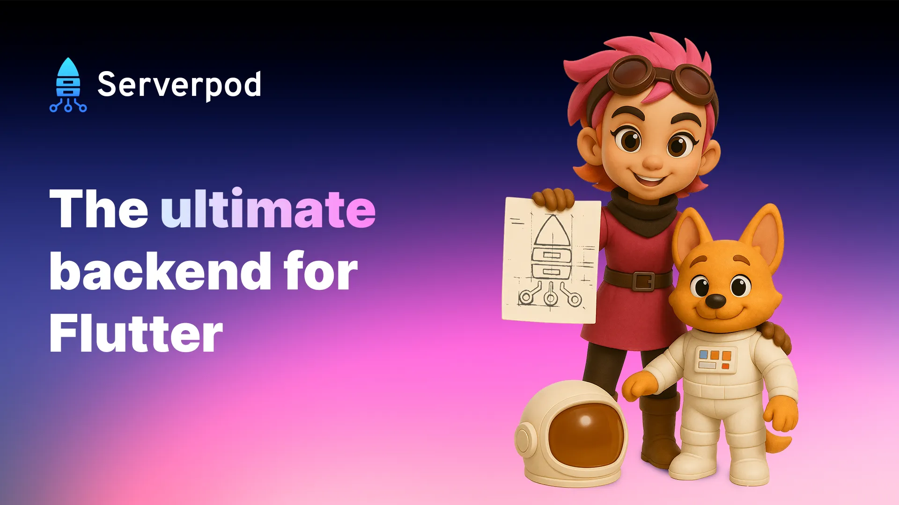

# Serverpod

[](https://pub.dev/packages/serverpod)
[](https://serverpod.dev/discord)

Serverpod is the ultimate app-stack for agentic coding. It is a complete, open-source solution for your app, backend, website, and database, all using Flutter and Dart. You write your server in the same language as your app. Serverpod generates the type-safe client, the database schema, and the migrations. One command runs your whole stack locally with hot reload, and one more publishes it to the cloud.

**[Get started](https://docs.serverpod.dev/quickstart)** · **[Documentation](https://docs.serverpod.dev)** · **[Serverpod Cloud](https://serverpod.dev/cloud)** · **[Discord](https://serverpod.dev/discord)**

## Why Serverpod

- **Full-stack type safety:** Define a model once and use it in your endpoints, your database queries, and your Flutter app. Calling the server is a regular Dart method call, checked by the compiler.
- **Hot reload for your entire stack:** One command, `serverpod start`, runs the server, the database, and your Flutter app, and watches all of it. Change an endpoint or a model, and Serverpod regenerates the code and reloads both server and app.
- **No setup for the database:** New projects run on an embedded Postgres that Serverpod downloads and manages for you. You don't need Docker to get started.
- **Tests against a real server:** The built-in test framework boots your Serverpod and a real, isolated database inside `dart test`. You call your endpoints directly, with no HTTP mocking.
- **Zero-configuration deployments:** Publish your backend, database, and Flutter web app to [Serverpod Cloud](https://serverpod.dev/cloud) with a single command. No pipelines, no Terraform, no DevOps. Plans start at $5 per month.
- **Open source, no lock-in:** Serverpod runs anywhere you can run Dart. Serverpod Cloud is a convenience, not a requirement.

More than 400 developers start a new project with Serverpod every month, and it's used in production by startups, app agencies, banks, and medical companies.

## Built for coding agents

Serverpod is designed for building apps with an AI coding agent. When you create a project, pick your agent and Serverpod sets it up for you. Claude Code, Cursor, VS Code, Codex, Antigravity, and OpenCode are supported out of the box.

- **Agent skills turn your agent into a Serverpod expert:** Serverpod ships skills covering endpoints, models, the database, migrations, authentication, testing, deployment, and more. They ship inside the `serverpod` package, so each release comes with skills written for that release. Your agent doesn't have to guess from older APIs.
- **The MCP server connects your agent to your running app:** Through [`serverpod mcp-server`](https://docs.serverpod.dev/concepts/cli/commands/mcp-server), your agent can read server and Flutter app logs, hot reload the server and the app, and create and apply database migrations. It makes a change, sees it running, and reads the logs when something breaks, without you copying output back and forth.
- **Several agents can work at once:** With [`serverpod runner`](https://docs.serverpod.dev/concepts/cli/commands/runner), each agent runs its own server and database in its own Git worktree, so agents don't get in each other's way. Run `serverpod start` in any worktree to see what its agent sees.

## Getting started

You need [Flutter](https://docs.flutter.dev/get-started/install) 3.44.4 or later.

```bash
dart install serverpod_cli       # Install the Serverpod CLI
serverpod quickstart my_project  # Create a server, client, and Flutter app
cd my_project
serverpod start                  # Run the full stack with hot reload
```

The `serverpod start` command starts the database, runs your server, and opens your Flutter app.

Follow the [quickstart guide](https://docs.serverpod.dev/quickstart) for a full walkthrough.

> [!NOTE]
> Upgrading a Serverpod 3 project? Start with the [upgrade guide](https://docs.serverpod.dev/upgrading/upgrade-to-four).

## Build with Dart everywhere

### Define a model

Describe your data once, in YAML. Serverpod generates a Dart class from it for both your server and your app. The `table` key maps it to a database table.

```yaml
# my_project_server/lib/src/notes/note.spy.yaml
class: Note
table: note
fields:
  text: String
```

Then press `M` in the `serverpod start` terminal to create the table.

### Write an endpoint

An endpoint's methods are what your app calls. The `Note` class and its type-safe `db` API are generated from the model above.

```dart
// my_project_server/lib/src/notes/notes_endpoint.dart
class NotesEndpoint extends Endpoint {
  Future<Note> add(Session session, Note note) =>
      Note.db.insertRow(session, note);

  Future<List<Note>> list(Session session) =>
      Note.db.find(session, orderBy: (t) => t.id);
}
```

### Call the endpoint from your Flutter app

Serverpod generates a client that turns each endpoint method into a regular Dart call. There's no REST layer to write or keep in sync.

```dart
final notes = await client.notes.list();
```

### Test the endpoint against a real database

The generated test tools run your endpoints against a real server and database. Each test's changes are rolled back when it finishes.

```dart
withServerpod('Given Notes endpoint', (sessionBuilder, endpoints) {
  test('when adding a note then it is listed', () async {
    await endpoints.notes.add(sessionBuilder, Note(text: 'Hello'));
    final notes = await endpoints.notes.list(sessionBuilder);
    expect(notes.single.text, 'Hello');
  });
});
```

Run your tests with `dart test` from the `my_project_server` folder.

## Publish your app

```bash
serverpod cloud launch
```

This signs you in, creates your project on Serverpod Cloud, and publishes it. After that, `serverpod cloud deploy` publishes new versions. Your first project includes a one-month free trial, no credit card required. See [Deploy to Serverpod Cloud](https://docs.serverpod.dev/deployments/deploy-to-serverpod-cloud).

Prefer to host it yourself? Serverpod runs anywhere Dart runs. Every new project includes a `Dockerfile`, and the docs cover [other deployment options](https://docs.serverpod.dev/deployments/custom-hosting/choosing-a-strategy).

## Everything else that's included

- [ORM and migrations](https://docs.serverpod.dev/concepts/data-and-the-database/database/crud) for Postgres, with relations, transactions, pgvector, and PostGIS
- [Authentication](https://docs.serverpod.dev/concepts/authentication/setup) with email, Google, Apple, Facebook, GitHub, Microsoft, Firebase, and custom providers
- [Streaming methods](https://docs.serverpod.dev/concepts/endpoints-and-apis/streaming) for real-time communication using native Dart streams
- [Future calls](https://docs.serverpod.dev/concepts/scheduling/overview) that replace cron jobs and survive server restarts
- [File uploads](https://docs.serverpod.dev/concepts/endpoints-and-apis/file-uploads) to Serverpod Cloud, S3, Google Cloud Storage, Cloudflare R2, or your database
- [Caching](https://docs.serverpod.dev/concepts/endpoints-and-apis/caching) locally or across a cluster with Redis
- [Logging](https://docs.serverpod.dev/concepts/operations/logging) and [Serverpod Insights](https://docs.serverpod.dev/tools/insights), a companion app for monitoring your server in real time
- [A web server](https://docs.serverpod.dev/concepts/web-server/overview) for web pages, webhooks, and REST APIs, built on [Relic](https://github.com/serverpod/relic)
- [Health checks](https://docs.serverpod.dev/concepts/operations/health-checks) for your database and external services
- A [client-side SQLite database](https://docs.serverpod.dev/concepts/data-and-the-database/database/client-side-database) with the same ORM, watched queries that keep widgets up to date, and experimental offline sync with the server

## Community

- [Discord](https://serverpod.dev/discord) for questions and discussion
- [GitHub Discussions](https://github.com/serverpod/serverpod/discussions) for ideas and longer threads
- [Newsletter](https://serverpod.news) for release news, roughly once a month

Want to contribute? Read the [contribution guide](https://docs.serverpod.dev/contribute). More than a hundred developers have contributed code to Serverpod so far.

## License

All Serverpod packages are licensed under BSD-3, except for the main `serverpod` package, which uses the SSPL license. In short, you can use any of the client packages in your app without limitation. You can also host your Serverpod server without limitation, as long as you don't offer Serverpod as a cloud service to third parties (this is typically only relevant for cloud service providers).
